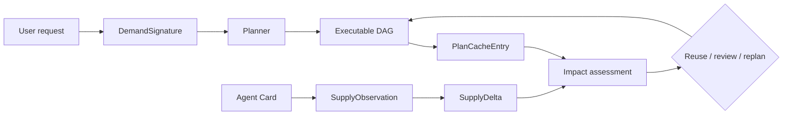

# Reference architecture

The design separates demand, observable supply, and plan evidence. Demand describes the user goal independently of the capabilities selected at one point in time. Supply describes the public capabilities exposed by an Agent Card. Plan evidence records the DAG and the exact capability dependencies used to produce it.
